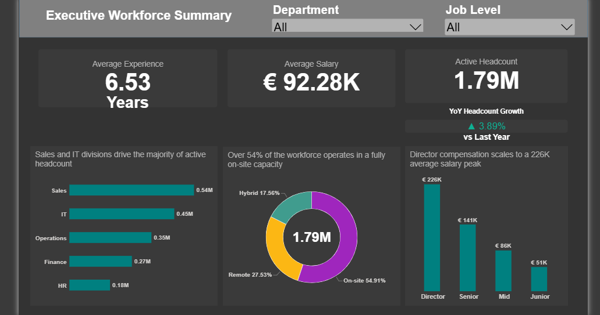
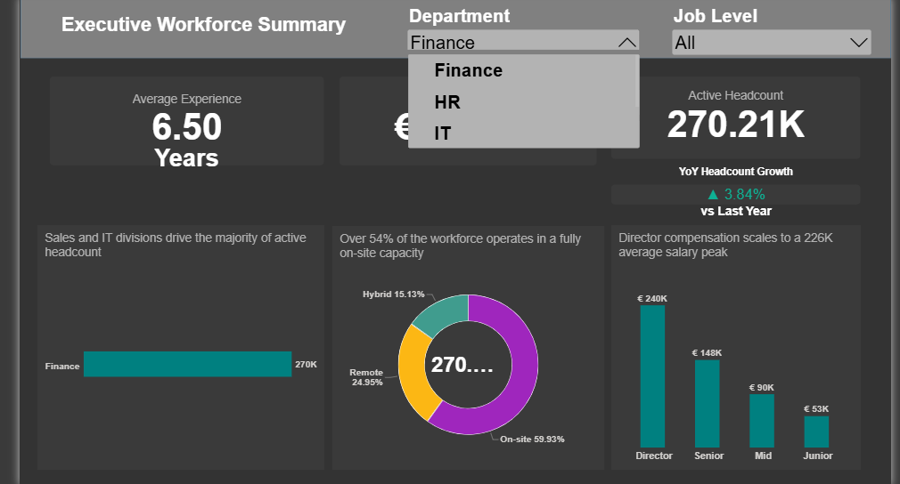
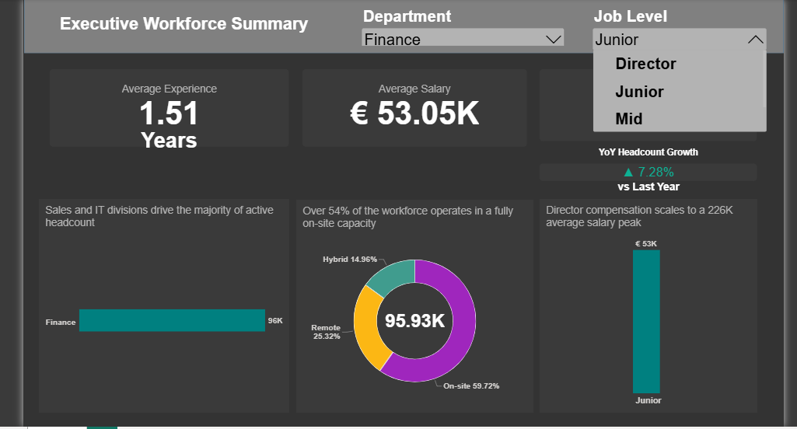
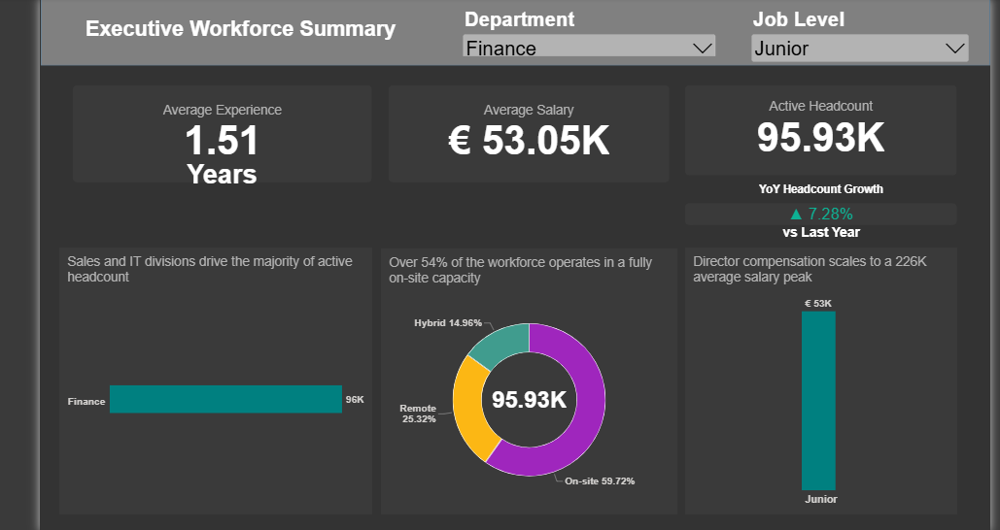

# Enterprise HR Analytics: 2M Rows Workforce Optimization

## 📌 Executive Summary
Designed and deployed a highly interactive Human Resources executive dashboard processing over **2+ million employee records**. Focused on headcount tracking, salary distribution, and workforce retention using advanced Data Modeling and Time-Intelligence DAX calculations.

## 🛠️ Tech Stack
* **Database & ETL:** PostgreSQL, pgAdmin4
* **Business Intelligence:** Power BI
* **Key Techniques:** Shift-Left Data Engineering, Star Schema Modeling, Anomaly Detection, Context-Aware DAX, Time-Intelligence

## 🚀 Architecture & Performance Optimization
To ensure maximum dashboard performance and strict data integrity, I implemented a robust backend data pipeline and advanced BI modeling techniques:
* **Shift-Left Data Engineering:** Architected a streamlined ETL pipeline in PostgreSQL to preprocess **2+ million raw records**. Offloaded intensive data sanitization tasks to the database layer, resolving negative anomalies via `ABS()`, standardizing string inputs, and casting optimized data types before BI ingestion.
* **Business Logic & Anomaly Detection:** Programmed strict logical constraints at the SQL level to enforce data integrity. Implemented custom business rules to flag and purge anomalous records, such as age-to-experience ratio violations and sub-threshold salary outliers based on hierarchical job levels.
* **Advanced Dimensional Modeling (Star Schema):** Engineered a highly optimized Star Schema data model. Overcame inherent DAX filter context limitations by architecting a dedicated, continuous **Date Table** mapped via 1-to-many active relationships to maintain continuous Time-Intelligence evaluation.
* **Dynamic Context-Aware DAX:** Developed complex DAX measures (utilizing `CALCULATE`, `SAMEPERIODLASTYEAR`, and robust `DIVIDE` zero-error handling) that dynamically respond to cross-filtering. This guarantees pinpoint accuracy for Year-over-Year (YoY) headcount growth across any granular Department or Job Level slicer combination.

## 📊 Dashboard Visuals

### 1. Executive HR Overview (Master Hero View)
*(Seamless cross-filtering showing Active Headcount and YoY metrics)*

### 2. Department-Level Slicer (Active Selection)
*(Demonstrating complex Time-Intelligence logic adapting to user selections)*

### 3. Job Level Slicer (Active Selection)
*(Granular filtering by Job Level while maintaining accurate YoY baseline)*

### 4. Applied Filters (Clean Executive View)
*(Clean executive view after multiple filters are applied)*

## 📂 Project Files
* **SQL Scripts:** Check `data cleaning.sql` in this repository to view the data sanitization logic, anomaly detection, and backend preparations.
* **Power BI Dashboard:** [Click here to view/download the interactive .PBIX file](https://drive.google.com/file/d/1WyL1r-j8kAnR2__9wxcD39B78on3SLNv/view?usp=sharing) (Hosted on Google Drive due to large enterprise data model size).
